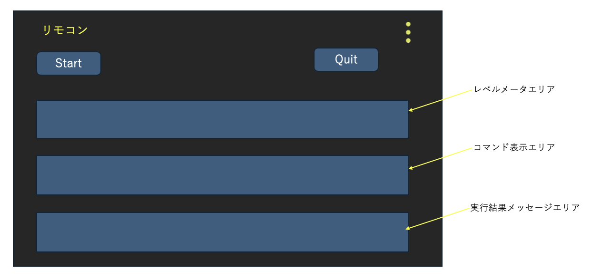
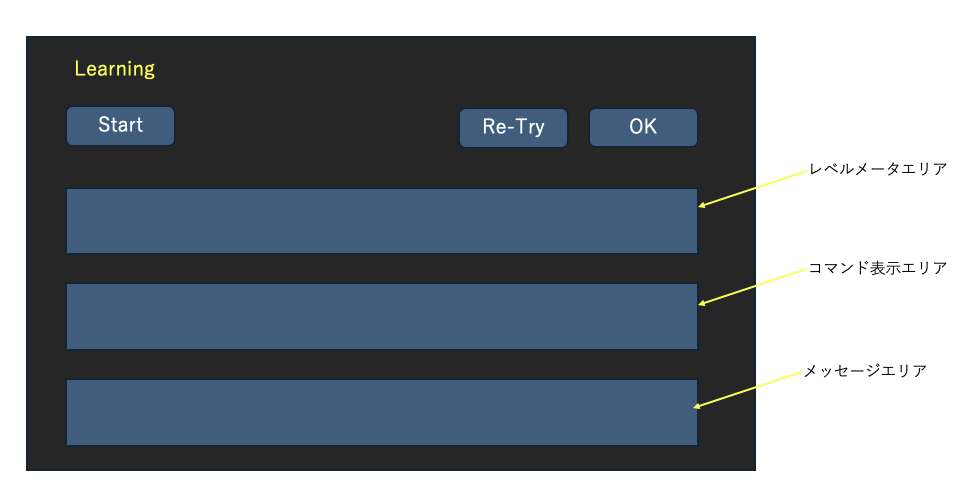
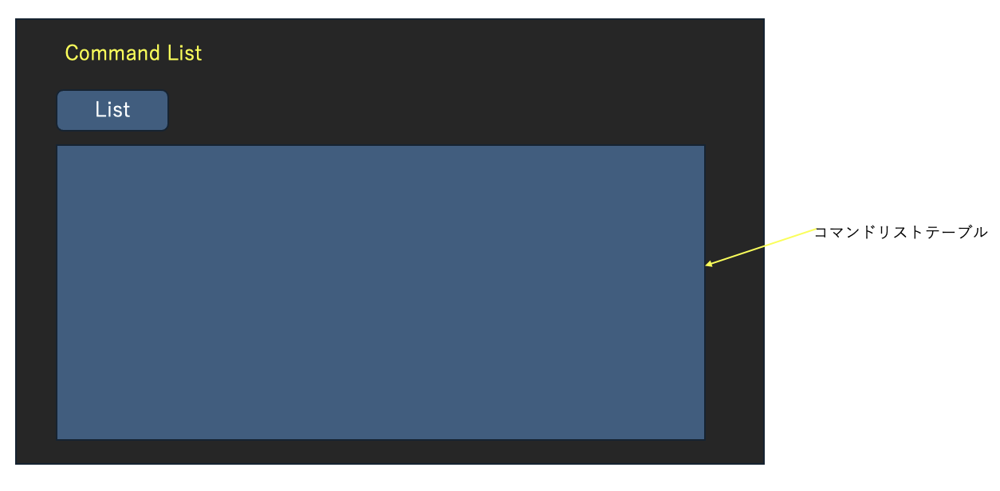
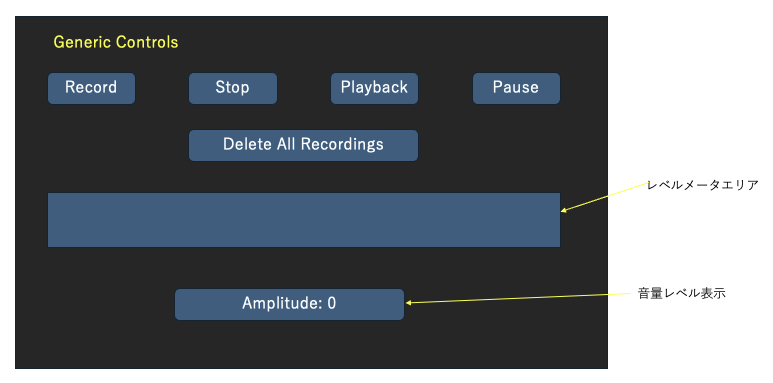
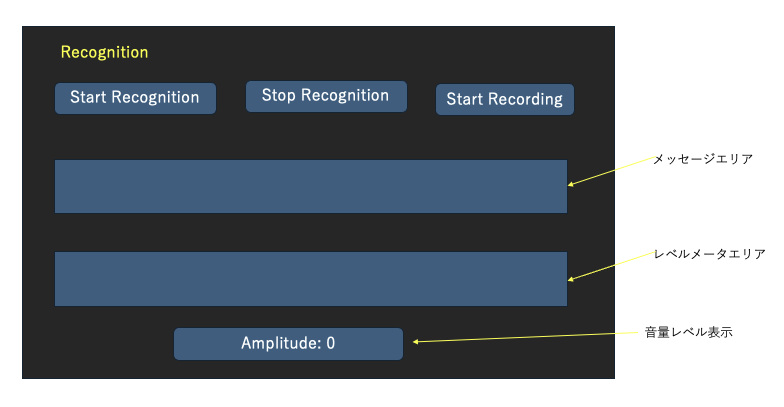

# Specification of VoiceRemocon

## システム概要

VoiceRemoconシステムは大きく２つのパートで構成される。

1. 学習リモコン部  
  raspberry pi zero 2w上に実装され、GPIOを用いて赤外線LED及び赤外線センサーを制御して学習リモコンを実現する。
2. 学習リモコン制御部  
  androidスマホ又はiPhoneに実装されGUIでの制御、音声認識での制御を行う。  

- 学習リモコン部と学習リモコン制御部はWiFiで通信してVoice Remocon システムを実現する。

### 学習リモコン部

学習リモコン部は raspberry pi zero 2w に実装され、raspberry pi zero 2wのGPIOを用いて赤外線LED及び赤外線センサーを制御する。  
詳細は raspberry pi zero 2w 上に実装している learning_voice_remocon プロジェクトを参照の事。

### 学習リモコン制御部

学習リモコン制御部はAndroidスマートホン又はiPhoneに実装されるアプリケーションであり、raspberry pi zero 2wとWiFi経由で通信を行い、
学習リモコン部を制御する。

#### 学習リモコン制御部の機能

学習リモコン制御部は以下の機能をもつ。

1. 音声コマンド認識機能
2. 認識したコマンドを学習リモコン部へ送信する機能
3. リモコンコード学習機能
4. 汎用操作機能

##### 音声コマンド認識機能

マイク入力による音声認識を行い、学習リモコン部に送信するコマンドを生成する。 音声認識と同時にファイルに録音し、音量レベルを表示する。認識が出来たら、認識結果と生成したコマンドを画面にメッセージとして表示する。　　

##### 認識したコマンドを学習リモコン部へ送信する機能

音声認識したコマンドを定型文字列に変換して、raspberry pi zero 2w に実装される学習リモコン部へWiFi経由で送信する。学習リモコン部は受信したコマンド文字列に誤りがなければ、Acknowledgeを返す。
コマンドに誤りがある場合はNackを返す。返された値に基づいてメッセージを画面に表示する。

##### リモコンコード学習機能

LearningFragmentを使い、学習リモコン部に学習させる。その結果を画面表示する。

#### Androidアプリの画面概要

- **RemoconFragment（リモコン）**：音声認識リモコン画面、マイク入力された音声を認識して結果を画面に表示する。コマンドを学習リモコン部へ送信する機能部を使ってコマンドを送信して、結果を画面表示する。
- **LearningFragment（学習）**：学習画面用のレイアウトを表示する。現在のFragment実装には画面操作や学習処理の接続は定義されていない。
- **CommandListFragment（コマンド一覧）**：コマンド一覧を表示する。
- **GenericControlsFragment（汎用操作）**：録音、再生、一時停止、停止、録音データの削除を行う画面。録音中は音量レベルを表示する。「Start」では録音を開始し、短い待ち時間の後に再生を開始する。録音中の再生や重複した録音開始は抑止する。
- **RecognitionFragment（音声認識）**：VOSKモデルの準備状態と認識結果を表示し、マイク入力による音声認識、停止、録音ファイルを使った認識を操作する画面。モデル準備完了までは操作ボタンを無効にし、認識中は音量レベルを表示する。認識結果は部分結果・確定結果・状態メッセージとして画面に反映する。

## システム仕様

### 画面仕様

#### RemoconFragment

画面レイアウトを図１に示す。  



- __Startボタン__  
  Startボタンを押すと、マイク入力による音声認識を開始する。
- **Quitボタン**  
  Quitボタンを押すと、学習リモコン部にQuitコマンドを発行する。
- __レベルメータ__  
  マイク入力中に音量レベルを表示する。音量レベルの更新は50msec毎とする。
- __コマンド表示エリア__  
  音声認識が成功して、認識した文からコマンドを抽出し、そのコマンドを表示する。
- __実行結果表示エリア__  
    認識したコマンドを学習リモコン部に送信し、その結果を表示する。
- __3点リーダーボタン__  
  設定ダイアログが開き、学習リモコン部のIP アドレスの設定を行う。

#### LearningFragment

画面レイアウトを図２に示す。  



- __Startボタン__  
  Startボタンを押すと、メッセージエリアに”学習させるリモコンのボタンを押してください。"というメッセージを表示して学習リモコン部へ学習開始コマンドを送信する。  
  学習リモコン部はリモコンの学習が終わったら学習終了を送信する。それを受信したら"対応するコマンドを話してください。"というメッセージをメッセージエリアに表示する。
- __レベルメータ__  
  マイク入力中に音量レベルを表示する。音量レベルの更新は50msec毎とする。
- __コマンド表示エリア__  
  対応するコマンドを音声認識したらその結果を文字列で表示する。  
- __Re-Tryボタン__  
  音声認識結果が適切で無ければ、このRe-Tryボタンを押すことで、音声によるコマンド認識を再度行うことができる。
- __OKボタン__  
  音声認識結果が適切であったらこのOKボタンを押すと、学習リモコン部に登録コマンドを送信する。学習リモコン部が正しく登録ができたら、その結果を送信する。その結果を受信してメッセージエリアに登録完了の旨を表示する。
- __3点リーダーボタン__  
  設定ダイアログが開き、学習リモコン部のIP アドレスの設定を行う。

#### CommandListFragment

画面レイアウトを図３に示す。  



- **Listボタン**
  Listボタンを押すと、学習リモコン部にgetCommandListコマンドを発行する。学習リモコン部はデータベースから全コマンドを読み出して、sendコマンド時に発行するフォーマットと機能名のリストをJSON形式で返す。学習リモコン制御部はJSON形式の文字列からフォーマットと機能名のリストを画面に表示する。

#### GenericControlsFragment

画面レイアウト図４に示す。



- __Recordボタン__  
  Recordボタンを押すと、マイク入力をファイルに録音する。
- __Stopボタン__  
  Stopボタンを押すと、録音を停止する。
- __Playbackボタン__  
  Playbackボタンを押すと、録音されたファイルを再生する。
- __Pauseボタン__  
  Pauseボタンを押すと、録音または再生を一時停止する。
- __Delete All Recordingsボタン__  
  Delete All Recordingsボタンを押すと録音されたファイルを削除する。
- __レベルメーター__  
  マイク入力中に音量レベルを表示する。音量レベルの更新は50mesc毎とする。
- __音量レベル__  
  マイク入力中に音量レベルを数値で表示する。音量レベルの更新は1秒毎とする。

#### RecognitionFragment

画面レイアウトを図５に示す。



- __Start Recognitionボタン__  
  Start Recognitionボタンを押すと、マイク入力から音声認識を行う。
- __Stop Recognitionボタン__  
  Stop Recognitionボタンを押すと、音声認識を停止する。
- __メッセージエリア__  
  音声認識結果を表示する。
- __レベルメーター__  
  マイク入力中に音量レベルを表示する。音量レベルの更新は50msec毎とする。
- __音量レベル__  
  マイク入力中に音量レベルを数値で表示する。音量レベルの更新は1秒毎とする。

### 通信仕様

学習リモコン部と学習リモコン制御部との通信プロトコルについては以下の様にする。

#### コマンド構成

学習リモコン制御部から学習リモコン部へのコマンドは以下の構成とする。 

| コマンド | コマンド引数 |  
|----|----|

#### コマンド

コマンドは以下の通りとし、コマンドの文字列をWiFiで指定したIPアドレスに送信する。

- **send** : コマンド引数で指定されたリモコンコードを送信する。
- **startLearning** : リモコンコードの受信を開始する。
- **storeCode** : 受信したリモコンコードを引数で指定した名前で登録する。
- **abortLearning** : リモコンコードの受信を中断する。
- **getCommandList** : リモコンコードに紐づいたフォーマットと機能名の一覧を取得する。
- **quit** : 学習リモコン部のアプリケーションを終了する。

#### コマンド引数

##### sendコマンド

send コマンドの引数は以下の通りとする。
学習リモコン部に登録済みの文字列を指定する。

| フォーマット | 機能名 | repeat | gap |
|----|----|----|----|

- フォーマット : SONY又は、OTHERSを指定する。
- 機能名 : 電源、エアコン自動等学習リモコン部のデータベースに登録済みの機能名
- repeat : 繰り返し回数（１〜 ２０回）
- gap : 繰り返し間隔（２０〜２０００msec）

##### startLearningコマンド

startLearningコマンドの引数は以下の通りとする。

| timeout |
|----|

- timeout : 学習スタート後timeout秒経過後学習を停止する。

##### storeCodeコマンド

storeCodeコマンドの引数は以下の通りとする。

| フォーマット | 機能名 |
|----|----|

- フォーマット :  SONY又は、OTHERSを指定する。
- 機能名 : 電源、エアコン自動等学習リモコン部のデータベースに登録する機能名

##### abortLearningコマンド

abortLearningコマンドは引数を取らない。

##### getCommandListコマンド

このコマンドは引数を取らない。

##### quitコマンド

このコマンドは引数を取らない。

#### レスポンス

学習リモコン部はコマンドの実行結果をレスポンスとして返す。

##### sendコマンドレスポンス

学習リモコン部はsendコマンドの実行が成功したら、Acknowledgeを返し、失敗したら、NotAckowledgeを返す。

##### startLearningコマンドレスポンス

学習リモコン部はstartLearningコマンドを受信して、リモコンコード受信状態になったら、WaitForLearningを返す。
リモコンコード受信完了したら、LearningCompleteを返す。タイムアウトが発生した場合は、LearningTimedOutを返す。

##### storeCodeコマンドレスポンス

学習リモコン部はstoreCodeコマンドの実行が成功し、データベースへの登録が完了したら、Acknowledgeを返す。
実行が失敗したら、NotAckknowledgeを返す。

##### abortLearningコマンドレスポンス

学習リモコン部はabortLearningコマンドの実行が成功したら、Acknowledgeを返す。
実行が失敗したら、NotAckknowledgeを返す。

##### getCommandListコマンドレスポンス

学習リモコン部は現在登録されているリモコンコードのデータベースから全リモコンコードに割り当てられたフォーマットと機能名を読み出し、JASON形式でリストとして返す。

###### JASON フォーマット例

```JASON
{
  "Format" : "SONY",
  "Name" : "テレビ電源"
}
```

##### quitコマンドレスポンス
学習リモコン部はこのコマンドを受信したら、すぐにAcknowledgeを返し、学習リモコンアプリケーションを終了する。
