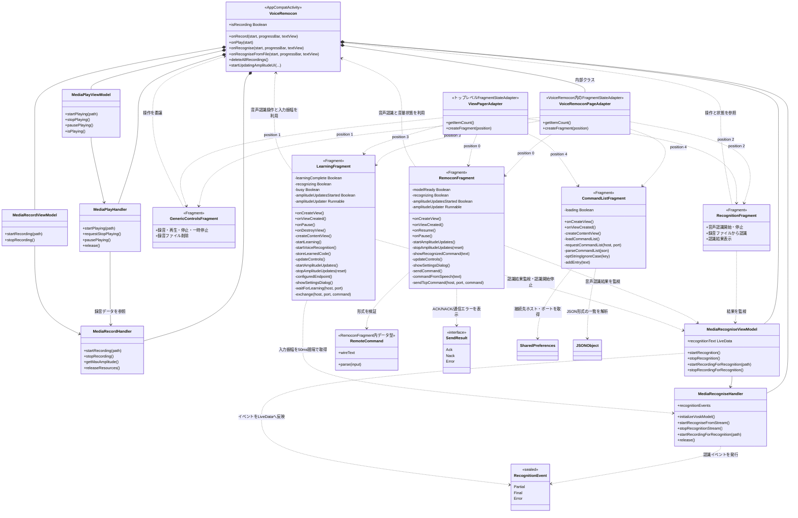

# VoiceRemocon クラス図

README の仕様と現在の Android 実装に基づくクラス図です。音声リモコン画面は `RemoconFragment`、認識エンジンと画面ホストは `VoiceRemocon` が担当します。

## 補足

`VoiceRemocon` 内部とトップレベルの2つの Pager Adapter が存在します。Activity は Pager Adapter を使って5画面を表示します。`RemoconFragment` と `LearningFragment` は同じ SharedPreferences の接続先設定（ホスト・ポート）を参照します。学習画面はTCPで `startLearning` の `WaitForLearning` / `LearningComplete` / `LearningTimedOut` を受け取り、音声認識後に `storeCode` を送信します。
